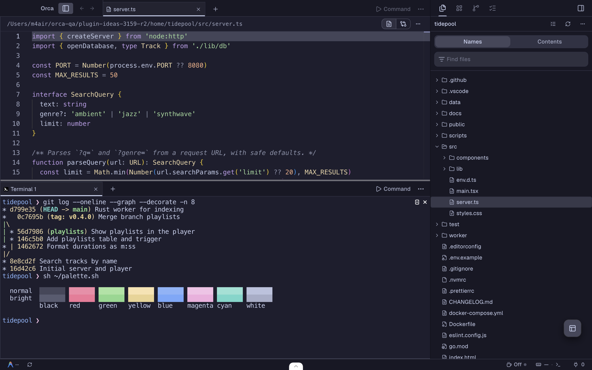
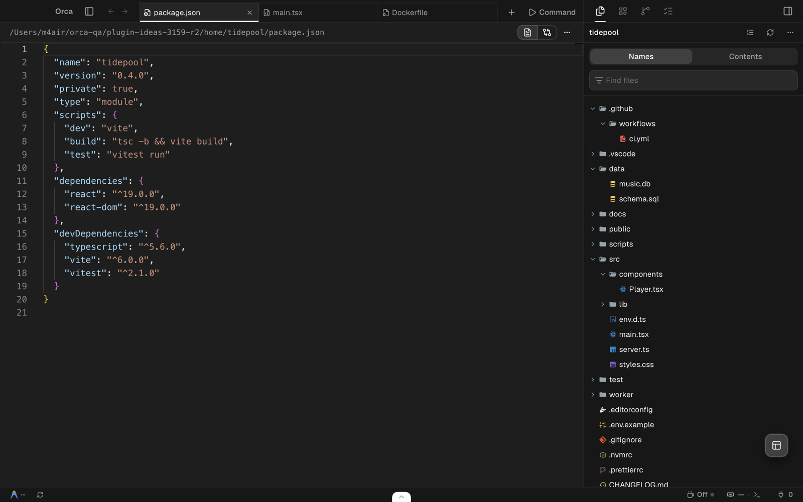

# Orca plugins

Three plugins for [Orca](https://github.com/stablyai/orca), installable from this repository's catalog.

| Plugin | What it does |
| --- | --- |
| [**Catppuccin**](plugins/catppuccin) | Soothing pastel themes: Mocha for dark mode and Latte for light mode, with matching code and terminal colors. |
| [**Material Icon Theme**](plugins/material-icons) | Colorful file icons for about 470 file types and names, with a variant for light themes. |
| [**SQLite Browser**](plugins/sqlite-browser) | Open `.db` and `.sqlite` files in an editor tab and browse every table, view, index and trigger. Read-only. |

[](plugins/catppuccin)

[](plugins/material-icons)

[](plugins/sqlite-browser)

## Install

These plugins need Orca 1.4.244 or later with plugins turned on.

1. In Orca, open **Settings → Plugins**.
2. Open the add menu, choose **Catalog sources…**, paste `https://github.com/brennanb2025/orca-plugins.git` and press **Add source**.
3. The three plugins now appear in the **All** tab. Open one and press **Install**.

Then pick what you installed:

- **Catppuccin:** choose Catppuccin Mocha and Catppuccin Latte in **Settings → Appearance**, and the terminal themes of the same names in **Settings → Terminal**.
- **Material Icon Theme:** choose Material Icons, or Material Icons (Light) for light themes, as the **Icon theme** in **Settings → Appearance**.
- **SQLite Browser:** open any `.db`, `.sqlite`, `.sqlite3` or `.db3` file.

Orca updates each plugin from this catalog, and asks you to review any update that needs more access.

## Repository layout

| Path | What it is |
| --- | --- |
| `plugins/` | One directory per plugin, each with its `orca-plugin.json` manifest and license. |
| `orca-catalog.json` | The catalog Orca reads. Each release is pinned to an exact commit and a hash of the plugin's files. |
| `assets/` | Screenshots shown on each plugin's page in Orca and in these READMEs. |
| `tools/` | Scripts that generate the Catppuccin themes and Material icons from their upstream releases, and the demo project the screenshots use. |
| `scripts/` | Catalog checks, run by CI on every push. |

To release a change, bump `version` in the plugin's manifest, commit the plugin on its own, then write and commit its release entry with an Orca checkout that has its dependencies installed:

```sh
ORCA_DIR=/path/to/orca node scripts/release-entry.mjs --write
ORCA_DIR=/path/to/orca node scripts/check-catalog.mjs
```

## Credits

- Colors from [Catppuccin](https://github.com/catppuccin/catppuccin) (MIT).
- Icons from [Material Icon Theme](https://github.com/material-extensions/vscode-material-icon-theme) (MIT).

Each plugin directory has its own `LICENSE`.
